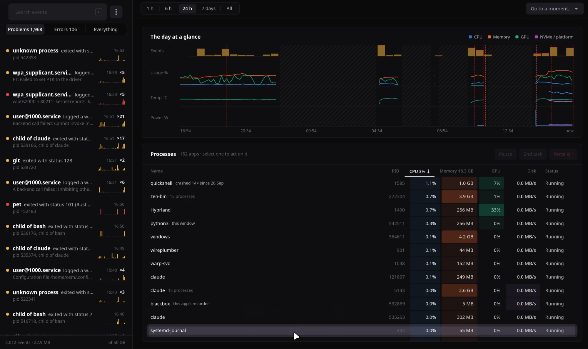

# Blackbox

**A flight recorder for a Linux desktop.** A small Rust service runs all the time and keeps what you
need after something goes wrong: crashes, error logs, failed logins, package upgrades, freezes and
system load. A desktop app shows any of those moments together with everything else that was
happening on the machine at the time.

> **Runs on any systemd Linux.** It reads package history from pacman (Arch), apt (Debian, Ubuntu),
> dnf (Fedora, RHEL, Rocky, Alma) and zypper (openSUSE), and CI builds and tests it on each of those
> distributions. It needs systemd and journald, and reads NVIDIA GPU stats if `nvidia-smi` exists.



## Why

When a desktop freezes, a program crashes or a login fails, the evidence is spread across the
journal, the audit log, coredumps and the package manager's log. By the time you go looking, part of it has
usually rotated away, and nothing lines it up in time. So "what happened at 14:02, and what else was
going on?" means an hour of `journalctl` and `grep`.

Blackbox answers that question in one click. It records continuously, into one SQLite file, and
costs so little that you never notice it running.

## What it records

| Source | What is kept |
|---|---|
| **Processes** | Every crash (SIGSEGV, SIGABRT, SIGBUS, SIGILL, SIGFPE, SIGTRAP, SIGSYS), named and with its stack trace from systemd-coredump, and every other failed exit (status 2 or higher), such as a Rust panic (101). A script stopped by Ctrl-C, `timeout` or systemd (130, 143, …) is not a failure and is skipped |
| **System** | CPU, memory, disk I/O and load every 10 s, NVIDIA GPU load, memory and temperature every 30 s |
| **Power and temperatures** | Every 10 s: battery state and draw, CPU package, cores, uncore, DRAM and whole-platform watts (RAPL), GPU watts, and every hwmon temperature and fan (CPU cores, NVMe drives, DRAM modules, Wi-Fi). CPU watts need one `sudo` step, which `deploy/install.sh` offers |
| **journald** | Warnings and worse, plus Rust panics (which are logged at info level) |
| **auditd** | Failed logins and authentication, sudo use, kernel module loads, edits to identity and boot files, audit anomalies |
| **Packages** | Every pacman, apt, dnf or zypper transaction, with kernel, driver and systemd upgrades listed first |
| **Boots** | Every boot, and any previous boot that ended without a clean shutdown (a freeze, a kernel panic, a power loss), placed at the moment it stopped |

It deliberately does **not** record every fork, exec or clean exit. That would be about 100 events a
second of noise and would bury the few that matter.

## How it works

```
 kernel process events ──(BPF filter)──► collector ─┐
 /proc, nvidia-smi ─────────────────────► sampler ──┤
 journalctl --follow ───────────────────► journald ─┼──► writer ───────► blackbox.db ◄── Blackbox app
 audit.log ─────────────────────────────► auditd ───┤    one thread,      SQLite, WAL,   GTK4, read-only,
 package history ───────────────────────► packages ─┤    one transaction  50 GB ring     runs only while
 previous boot's last journal entry ────► boot ─────┘    per burst        buffer         its window is open
```

One process (`blackbox`, a systemd user service) runs each source on its own thread; sources hand
what they find to one writer thread, which commits everything queued in one transaction, so a burst
costs one disk sync instead of one per row. A source that crashes is restarted instead of going
silent. The viewer is a separate app that only reads the database and never talks to the service.

What makes it both cheap and trustworthy:

- **Filtering in the kernel.** Process events come from the kernel's netlink process connector. A
  classic BPF program attached to the socket drops forks, thread exits and clean exits before they
  are queued, so the service only wakes up for exits worth storing. A unit test runs the filter
  through a small BPF interpreter for all 65,536 possible wait statuses and checks that it agrees
  with the Rust rule it mirrors.
- **Batching.** After an event the collector waits 100 ms and then handles the whole burst at once.
  Together with the kernel filter, that took it from 98 to 136 wakeups a second down to 8.5.
- **Names for processes that are already gone.** An exit event carries no name, and `/proc/<pid>` has
  usually vanished by the time it arrives. The collector keeps a pid-to-name table fed by exec
  events. A crash that dumps core is renamed afterwards from systemd-coredump's journal entry, which
  also carries the full executable path.
- **Nothing lost on a restart.** The journald follower saves its journal cursor in the same
  transaction as each row, so it resumes exactly where it stopped. The auditd follower
  binary-searches the audit log for the first record it has not stored yet.
- **Writes that survive a hard freeze.** SQLite runs in WAL mode with `synchronous=FULL`, so every
  event is on disk before the next one. With the usual `NORMAL`, the last ~30 s would sit in the page
  cache and die with the machine, and those seconds are exactly what a flight recorder is for.
- **Freezes are detected at the next boot.** Nothing can write while the machine is frozen. At
  startup Blackbox reads the previous boot's last journal entry: a clean shutdown always ends with
  journald's "Journal stopped", so anything else is stored as an unclean end at the moment the log
  stopped.
- **A size cap that never stalls the recorder.** The database is a ring buffer capped at 50 GB.
  When it is full, the oldest tenth of the recorded time span is deleted from every table together,
  in chunks of 1,000 rows with the lock released in between. In the stress test, the worst write
  during a trim dropped from 1,217 ms (one big delete) to a few milliseconds (7.4 ms on this
  machine's NVMe), and it does not grow with the database size.

The full design, with the measurements behind each decision, is in
[docs/architecture.md](docs/architecture.md).

## What it costs

Measured on this machine (22 cores, Arch Linux) with the installed service:

| | |
|---|---|
| CPU | **0.14% of one core**, including its `journalctl` and `tail` helpers |
| Memory | **about 6 MB** of private memory for the whole service |
| Wakeups | **under 10 a second** |
| Disk | about 1 MB a day at the current event rate |

The memory figure is the cgroup's `anon` counter. `systemctl status` shows a much larger number
because it includes page cache: `journalctl` maps journal files into memory, and the kernel can
reclaim those pages at any time.

## Install

You need Rust 1.88 or newer, a C compiler and SQLite's development files. The viewer also needs
PyGObject with GTK 4 and libadwaita. On a server without them, the viewer is skipped and the
recorder still runs.

| Distribution | Recorder | Viewer |
|---|---|---|
| Arch | `sudo pacman -S --needed rust sqlite` | `python-gobject gtk4 libadwaita` |
| Debian, Ubuntu | `sudo apt install build-essential libsqlite3-dev`, Rust from [rustup](https://rustup.rs) (the packaged one is too old) | `python3-gi gir1.2-gtk-4.0 gir1.2-adw-1` |
| Fedora, RHEL, Rocky, Alma | `sudo dnf install cargo gcc sqlite-devel` (or rustup if dnf's Rust is older than 1.88) | `python3-gobject gtk4 libadwaita` |
| openSUSE | `sudo zypper install cargo gcc sqlite3-devel` | `python3-gobject typelib-1_0-Gtk-4_0 typelib-1_0-Adw-1` |

```bash
git clone https://github.com/HawkOsm/BlackBox.git
cd BlackBox
deploy/install.sh
```

No sudo needed. It checks the build tools first and, if any are missing, prints the install command
for your distribution. It then builds the release binary, starts the recorder as a systemd user
service (it starts at boot, since lingering is enabled), adds **Blackbox** to the application menu,
and finishes with `blackbox --check`.

To see what the recorder can read on this machine, and the one command that opens up each source it
cannot, run this at any time:

```bash
deploy/install.sh check     # or: blackbox --check
```

For the auditd source (needs sudo once):

```bash
sudo bash deploy/setup-auditd.sh
```

This installs auditd if it is missing, loads the audit rules, caps the audit log at 2 GB and makes it
readable by your admin group: `wheel`, `adm` or `sudo`, whichever you are in (set `BLACKBOX_GROUP`
to choose). The rules watch the boot files of every distribution (mkinitcpio, dracut,
initramfs-tools, GRUB, systemd-boot), but only those that exist are loaded. To see what this machine
would get, run `bash deploy/setup-auditd.sh --print-rules`.

On Debian, a new user is not in a group that may read the system journal. `blackbox --check` says
so, and `sudo usermod -aG systemd-journal $USER` (then log in again) fixes it.

To remove everything, run `deploy/install.sh uninstall`. Add `--purge` to delete the recorded data
too.

Prefer a package? `deploy/aur/` has a `PKGBUILD` you can build yourself with `makepkg -si`. It is
not on the AUR yet.

## Use

Open **Blackbox** from the app menu. It only runs while its window is open.

- The list shows problems grouped by day. Repeats of the same message fold into one row with a count
  (`×218`), even when only a pid differs.
- Click any entry to see:
  - charts of usage, temperature and power around it (±2 min, ±10 min or ±1 h),
  - a crash's stack trace,
  - the package changes from the week before,
  - every other event in that window.
- The clock button opens any moment you pick, even one where nothing was recorded, such as a
  freeze.
- The copy button puts a plain-text report of the selected moment on the clipboard.
- The header shows whether the recorder is alive.

From a terminal:

```bash
systemctl --user status blackbox    # is the recorder running
journalctl --user -u blackbox       # its own log
```

The data lives in `~/.local/share/blackbox/blackbox.db`.

## Settings

Environment variables in `deploy/blackbox.service` (or the installed copy in `~/.config/systemd/user/`):

| Variable | Default | Meaning |
|---|---|---|
| `BLACKBOX_DB` | `~/.local/share/blackbox/blackbox.db` | database path |
| `BLACKBOX_MAX_MB` | `50000` | database size cap |
| `BLACKBOX_BATCH_MS` | `100` | how long process events may pile up before they are handled |
| `BLACKBOX_AUDIT_LOG` | `/var/log/audit/audit.log` | audit log to follow |
| `BLACKBOX_PACMAN_LOG` | `/var/log/pacman.log` | pacman log to read |
| `BLACKBOX_APT_LOG` | `/var/log/apt/history.log` | apt history to read |
| `BLACKBOX_ZYPPER_LOG` | `/var/log/zypp/history` | zypper history to read |
| `BLACKBOX_DNF_DB` | dnf5's, else dnf4's history database | dnf history database to read |

Every package history that exists is read, so normally none of these need setting.

A lower `BLACKBOX_BATCH_MS` names more short-lived processes at the cost of more wakeups: at 0 ms it
is about 50 wakeups a second.

## Privacy

The database holds process names, log lines and audit events, so it never belongs in git. It lives
in `~/.local/share/blackbox/` (directory mode 700, files 600), and `.gitignore` blocks databases,
logs, crash dumps and keys.

## Limits

- Exits with status 1 are not stored. Status 1 is what `grep`, `pgrep` and `modprobe` return for "not
  found", hundreds of times a minute, so a real failure with status 1 is indistinguishable from them.
- A process that fails within ~100 ms of starting, without dumping core, usually has no name, only
  its parent's.
- After downtime, audit records that rotated into `audit.log.1` in the meantime are missed.
- A bare `dpkg -i` or `rpm -i` is not recorded: only apt and dnf write it to their history.
- zypper logs an upgrade as an install of the new version, so its rows have no old version.
- If the kernel's event queue overflows during a burst, events are dropped, and the recorder logs
  that it happened.

## Repository

```
src/main.rs        arguments, then start the database and every source
src/check.rs       blackbox --check: what the recorder can see on this machine
src/sources/       what the recorder watches, grouped by how the data arrives:
  kernel/collector   process exits and crashes from the kernel (netlink process connector)
  follow/journald    journal warnings and panics (journalctl --follow)
  follow/auditd      the audit log (tail -F)
  poll/sampler       CPU, memory, disk, load, GPU, power and every sensor, every 10 s
  poll/packages      pacman, apt, zypper and dnf history, every 30 s
  once/boot          each boot, and whether the previous one ended cleanly
src/database/      the connection, the writer thread, the schema, the ring-buffer trim
tests/             end-to-end tests of the real binary
ui/                the GTK4 app: blackbox_app.py starts it, window.py is the window, data.py the queries
deploy/            installer, systemd unit, desktop entry, icon, audit rules; distro.sh holds what differs
                   between distributions (admin group, package manager)
.github/           CI: lint and tests, plus a build-and-test run inside each supported distribution
docs/              how it works and why (see below)
```

Each folder has a file of the same name next to it (`sources/follow.rs` beside `sources/follow/`)
that says what the folder is for and lists its files.

## Docs

- [docs/architecture.md](docs/architecture.md): how it works, source by source, with measurements.
- [docs/database.md](docs/database.md): every table and column, and how to query them.
- [docs/development.md](docs/development.md): building, testing, running it against a throwaway
  database, counting commits.
- [docs/adding-a-source.md](docs/adding-a-source.md): the recipe for a new source, with a worked
  example.
- [docs/decisions/](docs/decisions/): the design decisions, with the options that lost.

## Develop

```bash
cargo fmt --check && cargo clippy --all-targets && cargo test
cargo test --release trim_does_not_stall_writers -- --ignored --nocapture   # stress test
python3 ui/blackbox_app.py --db some.sqlite --screenshot out.png --select-first
python3 ui/blackbox_app.py --db some.sqlite --screenshot out.png --select 2 --style dark --size 400x760
```

About 80 tests, each next to the code it tests, plus end-to-end tests of the real binary; what
they cover, and the rule that a test must be seen to fail, are in
[docs/development.md](docs/development.md).

CI also runs `.github/scripts/distro-test.sh` inside Arch, Debian, Ubuntu, Fedora, Rocky Linux and
openSUSE containers. It builds and tests there, installs a package, and checks that the recorder
finds that package in the distribution's real history. To run it locally:

```bash
podman run --rm -v "$PWD:/src:Z,ro" -w /src -e CARGO_TARGET_DIR=/tmp/target debian:trixie bash .github/scripts/distro-test.sh
```

Screenshots also render headless: start `gtk4-broadwayd :7`, then run the app with
`GDK_BACKEND=broadway BROADWAY_DISPLAY=:7 GSK_RENDERER=cairo`.

## License

GNU GPL v3 or later, see [LICENSE](LICENSE).
